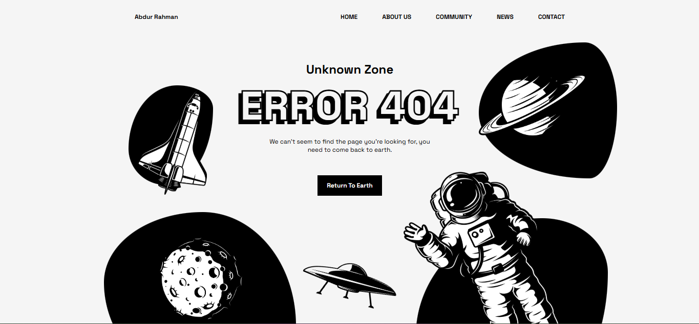

# Animated 404 Error Page

A responsive, space-themed 404 page built with **HTML, CSS, and JavaScript**. The page pairs an illustrated astronaut and spacecraft scene with a clear not-found message and navigation back to the main site.

## Features

- Space-themed error illustration
- Responsive layout
- Animated visual elements
- Navigation menu behavior for smaller screens
- Home navigation action

## Run locally

Open `Error404/index.html` in a browser. The `Error404/assets/` directory contains the page stylesheet, JavaScript, and illustration assets.

## Built with

- HTML5
- CSS3
- Vanilla JavaScript
- GSAP animation library
